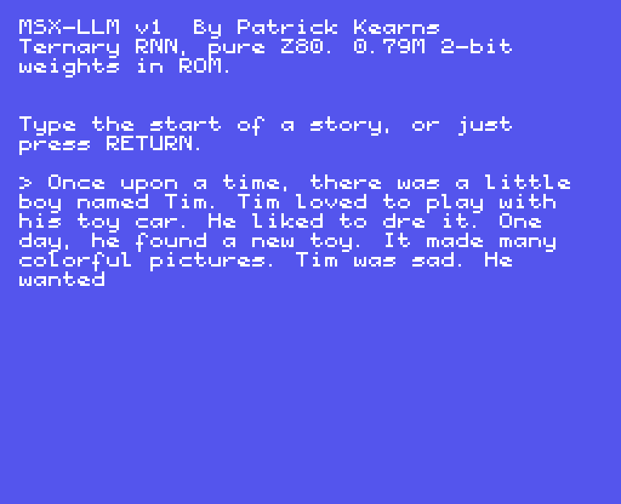

# msx-llm: a ternary language model on a stock MSX1

A tiny language model that runs on an **unmodified MSX1**: a 3.58 MHz Z80 with 64 KB of RAM.
There is no turbo R, no R800, no FPGA or coprocessor cartridge, and no speed-up.
The weights live in a 512 KB **ASCII8 MegaROM** image. You type the start of a story, and the
MSX continues it one token at a time, at about **4.1 seconds per token** (measured on an
emulated MSX1).



The idea is the "pure" counterpart of the 2.2M-parameter model on a Super Nintendo
(The Register, 21 Nov 2026), done with:

* **ternary weights** {-1, 0, +1} (BitNet b1.58 style), so the inner loop never multiplies;
* **a lookup-table matvec kernel** that adds 4 weights with one 16-bit table lookup;
* **a small BPE vocabulary** (1024 tokens), so the output layer stays affordable;
* **a recurrent model** instead of a transformer, so there is no KV cache and the cost per
  token is constant.

Everything is in this repository, end to end: the trainer, the exporter, the Z80 engine,
and bit-exact golden tests against a Python integer reference running in openMSX.

---

## Results (v1)

| | |
|---|---|
| Model | single-layer gated RNN (GRU without reset gate), E=128, H=384, V=1024 |
| Parameters | **786,432 ternary weights** (2 bits each) + 131,072 int8 embeddings + 1,792 int16 biases = **0.92 M** |
| ROM | 512 KB ASCII8 (8 KB code bank + 339 KB data used) |
| RAM used | 32 KB, 8000h–BFFFh only (page 2). Page 3 is left to the BIOS |
| Speed, measured | **4.14 s/token** on openMSX `C-BIOS_MSX1` (Z80 3.579545 MHz, MSX M1 wait states emulated) |
| Prompt cost | about 2.1 s per prompt token, plus greedy tokenisation |
| Golden tests | 6/6 cases bit-exact (prompt tokens, sampled tokens, final hidden state, all 1024 logits) |
| Quality | __QUALITY__ |

Sample generations, produced on the emulated MSX and identical to the Python reference:

__SAMPLES__

---

## Quick start

```powershell
# Python 3.11+ with numpy and torch (CPU)
py -m venv .venv
.venv\Scripts\python -m pip install numpy
.venv\Scripts\python -m pip install torch --index-url https://download.pytorch.org/whl/cpu

# Tools (official releases only): sjasmplus 1.24.0 and openMSX 22.0, unpacked into tools/
#   https://github.com/z00m128/sjasmplus/releases  -> tools/sjasmplus/sjasmplus-1.24.0.win/
#   https://github.com/openMSX/openMSX/releases    -> tools/openmsx/
# (openMSX ships C-BIOS, so no proprietary system ROMs are needed)

# Data: TinyStories V2 (GPT-4 subset). The first 250 MB of the training file is enough.
curl -L -r 0-249999999 -o data/ts_train_part.txt https://huggingface.co/datasets/roneneldan/TinyStories/resolve/main/TinyStoriesV2-GPT4-train.txt
curl -L -o data/ts_valid.txt https://huggingface.co/datasets/roneneldan/TinyStories/resolve/main/TinyStoriesV2-GPT4-valid.txt

.venv\Scripts\python train\prepare.py --vocab 1024 --vocab-bytes 20000000   # BPE vocab + tokenise (~1 min)
.venv\Scripts\python train\train.py --minutes 90                            # QAT on CPU
.venv\Scripts\python build.py --eval          # export + assemble -> build\msxllm.rom
.venv\Scripts\python tests\run_all.py         # bit-exact golden tests + s/token
```

Run it interactively:

```powershell
tools\openmsx\openmsx.exe -machine C-BIOS_MSX1 -carta build\msxllm.rom -romtype ASCII8
```

Real hardware: write `build/msxllm.rom` to any flash cartridge that can emulate an ASCII8
mapper, for example a MegaFlashROM SCC+ or a Carnivore2. You need at least 32 KB of RAM.
This has **not** been tried on a real MSX yet; see the limitations section.

---

## Architecture

### Why an RNN and not a transformer

The cost that matters here is Z80 cycles, and the Z80 has no multiply instruction.

* **Attention multiplies activations by activations** (q·k, softmax·v). With ternary
  weights, a matvec only adds and subtracts. Attention cannot do that. On the Z80, an 8×8
  multiply is roughly 150–250 T-states, against about 15 T-states per ternary weight.
* **A KV cache doesn't fit.** There is 64 KB of RAM in total, and the cartridge occupies
  page 1. An RNN state is 384 bytes.
* **Constant time per token.** The RNN does the same work for token 1 and token 200.

I dropped the GRU **reset gate**. With it, the candidate state needs `r ⊙ h` *before* a
second matvec. Without it, both gates read the same input vector `[x; h]`. That means one
pass over the input, one set of lookup-table builds, and no extra multiply. The 1/3 of
parameters it saves went into a bigger hidden state (H = 384).

### Model, with the exact integer semantics the Z80 runs

```
v      = [x_q ; h_q]                            int8, scale 1/127   (x = EMB[token])
y      = W_t · v + b                            int16 (wraps), W_t ternary, two matrices of H x (E+H)
z_q    = LUT_Z[clamp((y_z + rc_z) >> k_z)]      sigmoid, Q7 in 0..128
n_q    = LUT_N[clamp((y_n + rc_n) >> k_n)]      tanh x 127
h_q'   = h_q + ((z_q * (n_q - h_q) + 64) >> 7)  stays in int8, exactly (convex combination)
logit  = Wo_t · h_q' + bo                       int16, V = 1024
```

* **Ternary weights** follow BitNet b1.58: `W_t = clamp(round(W / mean|W|), -1, 1)`, one
  scale per tensor. The scale is **folded into the LUTs**: the shift `k` and the LUT
  contents depend on it, so the Z80 never rescales anything. 39% of weights are zero.
* **Activations are int8** with a fixed scale of 1/127. The GRU state is bounded by
  tanh, so it needs no dynamic absmax. Embeddings are clamped to [-1, 1] and stored as
  int8.
* **Training is quantisation-aware and emulates the integer pipeline exactly**: ternary
  STE, int8 rounding of `h` at every step, the LUT index computation, Q7 gates, and the
  `>> 7` update. As a result, the integer model's validation loss matches the float
  checkpoint's (see Results).
* **Normalisation.** There is no RMSNorm. The cheap equivalent is the bounded recurrence
  itself (tanh and sigmoid LUTs, plus a convex update), which keeps every activation in
  int8 range without a norm.
* **Sampling** is top-K (K=8) with a 256-entry `exp` LUT over logit differences
  (temperature 0.8, baked in at export). The draw uses a 16-bit xorshift PRNG seeded from
  the frame counter when RETURN is pressed. Greedy decoding is a RAM flag, used by the tests.
* **Tokenizer**: BPE learned on TinyStories word counts (1024 entries: `<eos>` + 78
  printable chars + merges). Encoding is **greedy longest match**, because that is
  trivial on a Z80 and identical in Python. Tokens never contain an inner space. That
  gives 3.37 chars/token on the validation set.

### The Z80 ternary matvec kernel

The obvious kernel (decode 2 bits, branch, add or subtract an int8 into a 16-bit
accumulator) costs about 34 T-states per weight. Instead, the kernel uses a lookup-table
trick (the same idea as T-MAC and LUT-based BitNet kernels):

1. The input vector is processed in **chunks of 64 values = 16 groups of 4**.
2. For each group, the engine precomputes all **81 possible sums**
   `±x0 ±x1 ±x2 ±x3` (with zeros) as 16-bit values. They go in a table indexed by the
   weight byte itself: lo bytes in page `80h+2g`, hi bytes in page `81h+2g`. One chunk of
   tables is 8 KB.
3. A weight byte holds 4 ternary weights (`00`=0, `01`=+1, `11`=-1). **One table lookup
   adds 4 weights.** Weights are streamed with `POP` (SP points into the ROM window,
   interrupts off).

```z80
.krow:  ld h,80h            ; table page for group 0
        pop bc              ; 2 weight bytes = 8 ternary weights
        ld l,c
        ld e,(hl) / inc h / ld d,(hl) / inc h     ; acc = T0[byte0]
        ld l,b
        ld a,(hl) / add a,e / ld e,a / inc h      ; acc += T1[byte1]  (16-bit,
        ld a,(hl) / adc a,d / ld d,a / inc h      ;  4 weights per 38 T)
        ... 14 more groups ...
        ld a,e / exx / add a,(hl) / ...           ; *y++ += acc   (y pointer in HL')
        dec c / exx / jp nz,.krow
```

Per row-chunk (64 weights), that's 821 T-states plus 163 M1 wait states (MSX adds one
wait state to every opcode fetch). Total: **984 T, or 15.4 T-states per weight**. The
kernel has no data-dependent branches, so its speed doesn't depend on the weights.

### ROM layout (ASCII8, 8 KB banks; window 6000h–7FFFh is switched via register 6800h)

| bank | contents |
|---|---|
| 0 | engine code (3.1 KB), mapped at 4000h–5FFFh |
| 1 | manifest (96 B: magic `MSXLLM01`, dims, shifts, block table), LUT_Z, LUT_N, LUT_E, vocab strings (length-prefixed, 5 KB) |
| 2–17 | embeddings, 1024 × 128 int8 (64 rows per bank) |
| 18–30 | gate biases (2H int16), then gate weights, packed 2 bits per weight, chunk-major (`[chunk][row][16 bytes]`) |
| 30–42 | output biases (V int16), then output weights, same packing |
| 43–63 | padding (0xFF) up to 512 KB |

The engine reads everything through the manifest's block table, so a retrained model of
the same shape only needs a re-export. Blocks are 16-byte aligned, so a row-chunk never
straddles a bank. The driver splits row ranges at bank boundaries.

### RAM map (all in page 2; page 2 is switched to the RAM slot at boot)

| address | size | use |
|---|---|---|
| 8000h–9FFFh | 8 KB | partial-sum tables, 16 groups × (lo page, hi page) |
| A000h–A7FFh | 2 KB | `Y`: 1024 × int16 accumulators (gate pre-activations or logits) |
| A800h–A9FFh | 512 B | `VEC` = [x (128) ; h (384)] int8 |
| AA00h–ACFFh | 768 B | LUT_Z, LUT_N, LUT_E (copied from ROM) |
| AD00h–AFFFh | 768 B | prompt text, token history (256 × u16) |
| B100h–B2FFh | 512 B | 9-entry pair tables, engine variables |
| B300h–BFFFh | | stack (SP starts at C000h) |
| C000h–FFFFh | | untouched (BIOS work area) |

---

## Cycle budget per token

* **Before implementation**: the parent plan estimated **5–15 s/token**, based on ~1 M
  weights at 20–30 T per weight with a direct add/sub kernel. The LUT kernel's design
  estimate was 13–14 T per weight + ~10% for table builds, which comes to **≈3.5–4 s**.
* **Instruction-count model vs measured.** The measurement is openMSX emulated time
  between `ev_token` breakpoints, broken down with breakpoints at each phase
  (`tests/run_golden.py --profile`):

| phase | work per token | model (T-states incl. M1 waits) | model (s) | **measured (s)** | share |
|---|---|---|---|---|---|
| ternary kernel | 12,288 row-chunks × 984 T | 12.09 M | 3.38 | **3.391** | 81.8% |
| table builds | 14 chunks × 16 groups × ~7.4 K T | 1.66 M | 0.46 | **0.477** | 11.5% |
| gate update (2 LUTs + 1 multiply per unit) | 384 units | ~0.5 M | 0.15 | **0.152** | 3.7% |
| top-K scan + LUT softmax + draw | 1024 logits | ~0.33 M | 0.09 | **0.092** | 2.2% |
| bias copies, embedding, printing | | ~0.1 M | 0.03 | **0.031** | 0.8% |
| **total** | | **14.7 M** | **4.11** | **4.14** | |

All-in, that's **18.9 T-states per ternary weight** (15.4 of them in the kernel).

---

## Tests

`tests/run_golden.py` runs the ROM **headless** in openMSX (`set renderer none`,
`throttle off`). A Tcl script sets breakpoints on the engine's `ev_ready`, `ev_token` and
`ev_done` labels (addresses come from the sjasmplus symbol file). It then types the
prompt with the `type` command and dumps RAM at the end. Python then compares these
against `train/intref.py`:

1. the prompt buffer (the Z80's input handling and normalisation),
2. the prompt token ids (the Z80 greedy tokenizer),
3. the generated token ids (the sampler, the PRNG and every matvec along the way),
4. the final int8 hidden state (384 values),
5. the final 1024 int16 logits.

`tests/run_all.py` runs 6 cases: sampling, greedy, an empty prompt, quotes and
punctuation, the 50 Hz `C-BIOS_MSX1_EU` machine, and a profiled run. Results go to
`build/test_results.json`. `tests/screenshot.py` renders SCREEN 0 straight from VRAM to a
PNG.

---

## Repository layout

```
train/prepare.py   BPE vocab + tokenise TinyStories -> data/*.bin
train/tok.py       normalisation, BPE learner, greedy longest-match encoder
train/model.py     ternary gated RNN with exact integer emulation (QAT)
train/train.py     CPU training loop (stateful TBPTT, AdamW, cosine)
train/intref.py    bit-exact integer reference of the Z80 engine + quantiser
export/pack.py     checkpoint -> integers, LUTs -> ASCII8 data banks + manifest
z80/engine.asm     the MSX engine (sjasmplus)
build.py           export + assemble
tests/             golden tests, test suite, VRAM screenshot
```

## Training details and data licence

* Data: **TinyStories V2 (GPT-4 generated)** from `roneneldan/TinyStories` on Hugging
  Face, licensed **CDLA-Sharing-1.0**. CDLA-Sharing allows using the data to train a model.
  Its sharing conditions apply when you redistribute the *data*, and trained models count
  as "Results", which those conditions don't cover. The data is not committed here: `data/` is
  gitignored. The first 250 MB of the training file (73 M tokens) was used.
* Training: __TRAINING__
* `<eos>` resets the hidden state to zero in training, which matches inference (the MSX
  starts from h=0 and feeds `<eos>` before the prompt).

## Known limitations and next steps

* **Not tested on real hardware.** It has only been tested in openMSX 22.0 on the C-BIOS
  MSX1 machines; proprietary MSX system ROMs were not available here. The engine only uses
  documented Z80 instructions, standard BIOS calls (`CHGET`, `CHPUT`, `INITXT`) and
  standard slot switching, which includes expanded RAM slots. It is still a hardware test
  waiting to happen.
* **Quality is "coherent-ish" at best.** It is a 0.9 M-parameter ternary RNN trained for
  90 minutes on a CPU. Grammar is mostly local, stories drift, and names and objects
  don't persist across sentences.
* **Fixed shape assumptions in the engine**: E = 128, H and E+H multiples of 64,
  E+H ≤ 512, 2H ≤ 1024, V ≤ 1024, vocab strings ≤ 7 KB.
* **Sampling settings are baked in at export**: temperature, top-K and max length (48
  tokens). The prompt is limited to 119 characters.
* **int16 accumulators can wrap** in theory. The reference reproduces the wrap
  bit-exactly, but it would hurt the output. It has never been observed.
* **openMSX automation quirk**: with C-BIOS, keys sent by openMSX's `type` command in the
  first ~1.5 s after the prompt appears get lost. The harness waits 4 s. Human typing
  isn't affected in practice.
* **Possible speed-ups**:
  * base-3 packing (5 weights per byte, 1.6 bits/weight) would cut kernel lookups and ROM
    by 20%;
  * 128-input chunks (16 KB of tables) would halve the per-row `y` update overhead (~5%);
  * a smaller vocabulary would shrink the output layer, which is half the weights.
* **Larger models fit**: the ROM still has 170 KB free and ASCII8 goes to 2 MB. The cost is
  linear: each extra 1 M ternary weights adds ≈ 5.3 s/token (18.9 T-states per weight).
